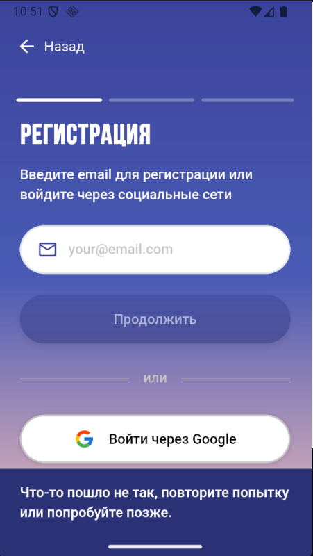
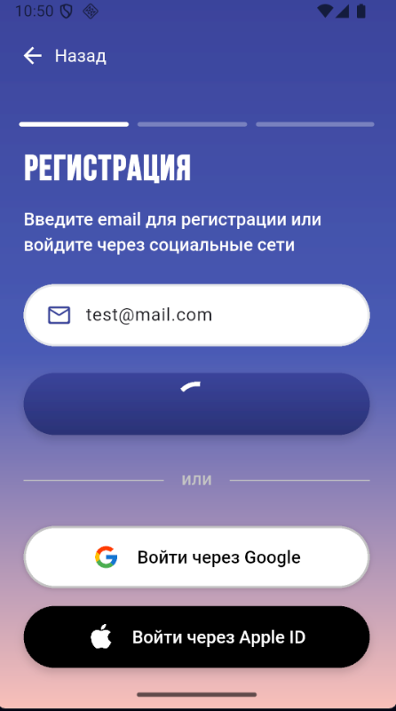

# Баг-репорты экрана регистрации

## ID
BR-REG001

## Исполнитель
Высоцкий Алексей Владимирович | 22.10.2026

## Заголовок
[Регистрация] Зависание приложения при валидном email

## Окружение
Android Studio Narwhal 4 Feature Drop | 2025.1.4, Android 16, Pixel 1

## Предусловия
1. Приложение запущено
2. Открыт экран регистрации (шаг 1 из 3)
3. Поле email пустое

## Шаги воспроизведения
1. Ввести email: test@mail.com
2. Нажать кнопку «Продолжить»
3. Наблюдать за реакцией приложения 30 секунд

## Ожидаемый результат
Переход на шаг 2 «Ввод пароля»

## Фактический результат
* Появляется индикатор загрузки
* Приложение не реагирует на действия
* Сообщение об ошибке: «[Что-то пошло не так, повторите попытку или попробуйте позже.]»
* Воспроизводимость: 3 из 3

## Severity / Priority
- Severity: Minor
- Priority: Low
- Обоснование: проблема связана с недоступностью тестового окружения

## Приложения
Скриншоты и видео воспроизведения

